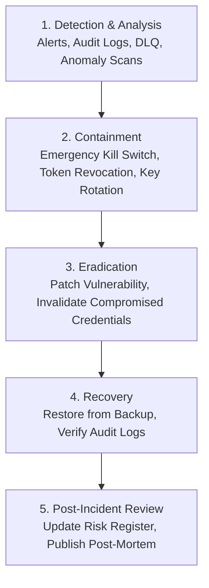

# VIREONIQ — Incident Response Plan & Security Playbooks

**Document Status**: `Draft Operational Runbook`

---

## 1. Incident Lifecycle & Response Workflow



---

## 2. Severity Classification

| Level | Criteria | Target Response Window |
| :--- | :--- | :--- |
| **SEV-0 (CRITICAL)** | Signing key compromise, active cross-tenant data leak, database outage | Immediate triage (target: 15 min) |
| **SEV-1 (HIGH)** | AI gateway outage, autonomous guard bypass, webhook delivery failure | Prompt engineering triage (target: 30 min) |
| **SEV-2 (MEDIUM)** | Repeated IDOR probe attempts, rate-limit anomaly | Same-day investigation |
| **SEV-3 (LOW)** | Non-critical dependency warning, transient upstream timeout | Scheduled backlog triage |

---

## 3. Incident Playbooks

### Playbook A: Autonomous Agent Anomaly / Kill Switch
1. **Containment**: Enable the kill switch on affected users via `automation_preferences`:
   ```sql
   UPDATE automation_preferences SET kill_switch_active = TRUE;
   ```
2. **Analysis**: Inspect `security_audit_logs` for `HIGH_IMPACT_ACTION_BLOCKED` or repeated events.
3. **Remediation**: Review user confirmations and re-verify Level 3 guard tests (`test_phase14_autonomous_career_os.py`).

### Playbook B: Secret / Credential Signing Key Compromise
1. **Containment**: Rotate `SECRET_KEY`, `CREDENTIAL_SIGNING_KEY`, and RSA JWT keys immediately outside the repository, then restart application processes.
2. **Analysis**: Query `security_audit_logs` for `CREDENTIAL_ISSUED` and auth anomalies in the exposure window.
3. **Remediation**: Revoke affected credentials (`POST /api/v1/credentials/{credential_id}/revoke`) and re-issue after verification.

### Playbook C: Webhook Delivery Outage & Dead Letter Queue (DLQ) Recovery
1. **Analysis**: Inspect `webhook_delivery_logs` where delivery failed or moved to DLQ.
2. **Remediation**: Restore the downstream webhook target and trigger retry logic (`platform_ecosystem_service.py`).

---

<div align="center">
  <sub>VIREONIQ — Operational Security Runbook</sub>
</div>
